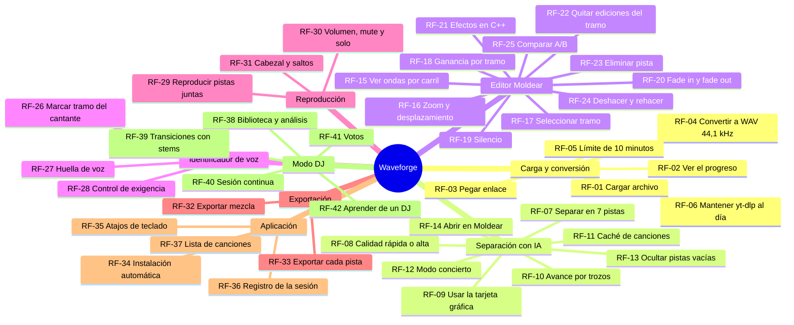

# Waveforge — Requerimientos

Proyecto individual de **Felipe Valentino Calderón Hurtado** · Programación de Interfases y Dispositivos Periféricos · 32688 · UTP 2026-II · Docente: Bryan Luis Solano Condor.

Los requerimientos están agrupados por módulo, para pasarlos directo a un mapa: **módulo → requerimiento → detalle**. Cada uno indica el archivo que lo cumple. Estado: ✅ hecho en `main` · 🧪 en la rama `funcion/modo-dj`.

## Mapa general

## Requerimientos funcionales

### 1. Carga y conversión

| ID | Requerimiento | Detalle | Archivo | Estado |
| --- | --- | --- | --- | --- |
| RF-01 | Cargar un archivo de audio o video | WAV, MP3, M4A, OGG, FLAC, MP4 y similares, desde el botón o el menú Archivo | `main.py`, `importador.py` | ✅ |
| RF-02 | Ver el progreso de la carga | Porcentaje de descarga y aviso mientras ffmpeg convierte | `importador.py`, `main.py` | ✅ |
| RF-03 | Pegar un enlace | YouTube u otro sitio compatible con yt-dlp; solo se descarga el video, aunque el enlace venga de una lista o Mix | `importador.py` | ✅ |
| RF-04 | Convertir a un formato único | Todo se lleva a WAV de 44 100 Hz, estéreo y 16 bits con ffmpeg | `importador.py`, `audio_io.py` | ✅ |
| RF-05 | Limitar la duración | Canciones de más de 10 minutos se rechazan antes de descargar o separar | `separador.py`, `importador.py` | ✅ |
| RF-06 | Mantener yt-dlp actualizado | Se instala si falta y se actualiza sola una vez al día, en segundo plano | `importador.py` | ✅ |

### 2. Separación con IA

| ID | Requerimiento | Detalle | Archivo | Estado |
| --- | --- | --- | --- | --- |
| RF-07 | Separar la canción en pistas | Voz principal, coros, batería, bajo, guitarra, piano y otros (Demucs + karaoke MDX-Net) | `separador.py` | ✅ |
| RF-08 | Elegir la calidad | Rápida (Demucs saca la voz) o Alta (Mel-Band RoFormer saca la voz) | `main.py`, `separador.py` | ✅ |
| RF-09 | Usar la tarjeta gráfica si existe | CUDA → DirectML → CPU, en ese orden | `separador.py` | ✅ |
| RF-10 | Mostrar avance por trozos | Primer trozo de 15 s y luego de 30 s; se puede escuchar lo ya separado | `separador.py`, `main.py` | ✅ |
| RF-11 | Guardar en caché | Las últimas 5 canciones separadas se abren al instante | `separador.py` | ✅ |
| RF-12 | Modo concierto | Casilla que separa al público (UVR-MDX-NET Crowd HQ 1) en su propia pista «Público» | `main.py`, `separador.py` | ✅ |
| RF-13 | Ocultar pistas vacías | Pistas por debajo de −40 dB (−30 dB coros y público) no se muestran | `separador.py` | ✅ |
| RF-14 | Abrir el resultado en el editor | Al terminar, las pistas se abren solas en Moldear | `main.py` | ✅ |

### 3. Editor Moldear

| ID | Requerimiento | Detalle | Archivo | Estado |
| --- | --- | --- | --- | --- |
| RF-15 | Ver cada pista en su carril | Forma de onda completa, sin trabarse (resumen de picos cada 256 muestras) | `editor.py`, `ediciones.py` | ✅ |
| RF-16 | Zoom y desplazamiento | Rueda, Ctrl+rueda, botones +/− y «ver la canción completa» | `editor.py` | ✅ |
| RF-17 | Seleccionar un tramo | Arrastrar sobre una pista elige el tramo; un clic solo mueve el cabezal | `editor.py` | ✅ |
| RF-18 | Subir o bajar el volumen del tramo | Operación `ganancia` en dB, con bordes suavizados | `ediciones.py` | ✅ |
| RF-19 | Silenciar el tramo | Operación `silencio` (tecla Supr) | `ediciones.py` | ✅ |
| RF-20 | Fade in y fade out | El tramo entra o se apaga de a poco | `ediciones.py` | ✅ |
| RF-21 | Aplicar un efecto de C++ al tramo | Pasa-bajos, pasa-altos, normalizar, puerta de ruido, ecualizador | `ediciones.py`, `motor.py`, `native/` | ✅ |
| RF-22 | Quitar las ediciones del tramo | Borra las ediciones que tocan el tramo elegido; se puede deshacer | `editor.py` | ✅ |
| RF-23 | Eliminar una pista | Se puede recuperar con deshacer | `editor.py` | ✅ |
| RF-24 | Deshacer y rehacer | Ctrl+Z / Ctrl+Y; el original nunca se modifica | `ediciones.py` (`Historial`) | ✅ |
| RF-25 | Comparar con el original (A/B) | Alterna entre la versión editada y la original | `editor.py` | ✅ |

### 4. Identificador de voz

| ID | Requerimiento | Detalle | Archivo | Estado |
| --- | --- | --- | --- | --- |
| RF-26 | Marcar el tramo del cantante | El usuario elige al menos 1 s (mejor 3 a 10) donde canta solo el artista | `editor.py` | ✅ |
| RF-27 | Reconocer la voz | Huella de 256 números (WeSpeaker) y parecido coseno cada 0,25 s | `identificador.py` | ✅ |
| RF-28 | Ajustar la exigencia | Control de 0 a 1; se recalcula al instante y queda como edición `curva` que se puede deshacer | `identificador.py`, `editor.py` | ✅ |

### 5. Reproducción

| ID | Requerimiento | Detalle | Archivo | Estado |
| --- | --- | --- | --- | --- |
| RF-29 | Reproducir todas las pistas juntas | Bloques de 1 024 muestras por la tarjeta de sonido (sounddevice) | `reproductor.py` | ✅ |
| RF-30 | Volumen, mute y solo por pista | Cambios sin saltos (rampa) y sin cortar la reproducción | `reproductor.py`, `editor.py` | ✅ |
| RF-31 | Mover el cabezal | Clic en la regla, Inicio, espacio para reproducir/pausar, detener | `editor.py` | ✅ |

### 6. Exportación

| ID | Requerimiento | Detalle | Archivo | Estado |
| --- | --- | --- | --- | --- |
| RF-32 | Exportar la mezcla | Las pistas activas, con volumen y ediciones, en un WAV | `editor.py`, `procesamiento.py`, `audio_io.py` | ✅ |
| RF-33 | Exportar cada pista por separado | Un WAV por pista en la carpeta que se elija | `editor.py` | ✅ |

### 7. Aplicación

| ID | Requerimiento | Detalle | Archivo | Estado |
| --- | --- | --- | --- | --- |
| RF-34 | Instalarse sola | `iniciar.bat` / `iniciar.sh`: crea `.venv`, instala librerías, compila el C++ y abre la app | raíz | ✅ |
| RF-35 | Atajos de teclado | Espacio, Supr, Ctrl+Z, Ctrl+Y, +, −, Inicio, Ctrl+A, Esc | `main.py` | ✅ |
| RF-36 | Registro de la sesión | Cargas, ediciones y errores en `registro.log`, visible desde Herramientas | `main.py` | ✅ |
| RF-37 | Lista de canciones de la sesión | Muestra las canciones cargadas en la sesión actual | `main.py` | ✅ |

### 8. Modo DJ (rama `funcion/modo-dj`)

| ID | Requerimiento | Detalle | Archivo | Estado |
| --- | --- | --- | --- | --- |
| RF-38 | Biblioteca con análisis | BPM, grilla de beats, compás, tonalidad (rueda Camelot) y energía; cada canción se analiza una vez | `dj_analisis.py` | 🧪 |
| RF-39 | Transiciones con stems | Recetas que deciden qué pista entra y cuál sale en cada compás; solo se separa el tramo de la transición | `dj_motor.py` | 🧪 |
| RF-40 | Sesión continua | Elige la siguiente canción por tempo, tonalidad y energía, sigue un plan por géneros y no repite | `dj_sesion.py` | 🧪 |
| RF-41 | Votos 👍 / 👎 | Ajustan qué transiciones y canciones se eligen después | `dj_sesion.py`, `dj_ui.py` | 🧪 |
| RF-42 | Aprender el estilo de un DJ | Desde el audio de una mezcla: cada cuánto cambia, duración y técnica de las transiciones | `dj_aprender.py` | 🧪 |

## Requerimientos no funcionales

| ID | Requerimiento | Cómo se cumple |
| --- | --- | --- |
| RNF-01 | La ventana nunca se congela | Todo lo lento corre en hilos; el resultado vuelve con `root.after` |
| RNF-02 | Separar más rápido que la canción | Calidad rápida, dos etapas en paralelo y GPU con DirectML |
| RNF-03 | Funcionar sin tarjeta NVIDIA | DirectML (cualquier GPU en Windows) y, si no hay, CPU |
| RNF-04 | Edición no destructiva | Lista de operaciones sobre una copia; deshacer es exacto |
| RNF-05 | Audio sin clics ni saturación | Rampas en bordes y volúmenes, `np.clip` en la mezcla |
| RNF-06 | Efectos eficientes | C++ compilado, llamado con ctypes sin copiar el audio |
| RNF-07 | Multiplataforma | Windows, Linux y Mac (scripts y librería para cada uno) |
| RNF-08 | Instalación en un paso | Doble clic en `iniciar.bat`; las siguientes veces solo abre |
| RNF-09 | Capas separadas | La lógica no importa Tkinter; cada módulo se prueba solo |
| RNF-10 | Requisitos de hardware | Mínimo 4 núcleos y 8 GB de RAM; recomendado 6 núcleos y 16 GB |
